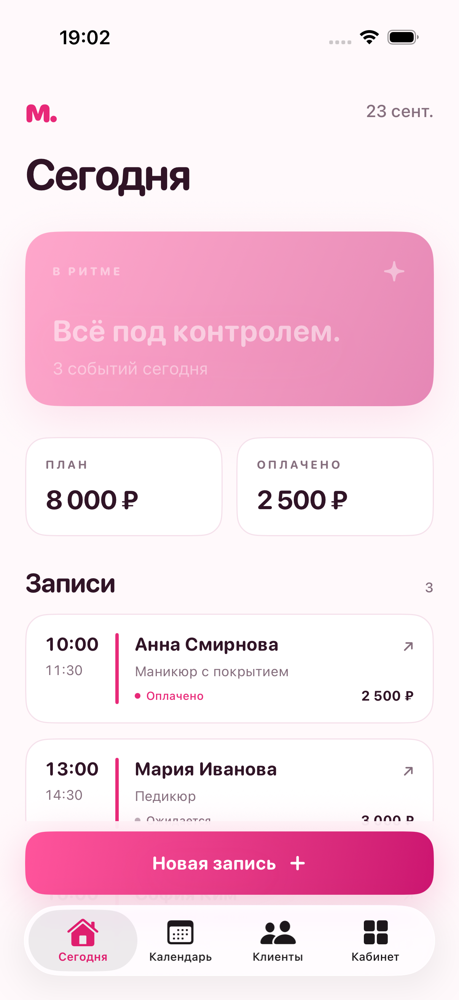
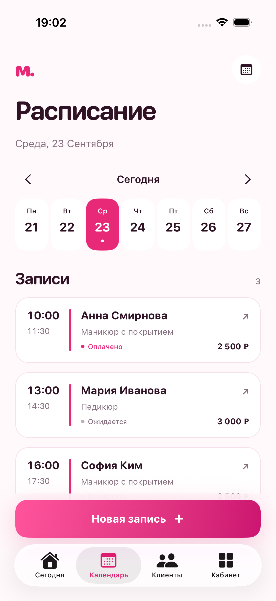
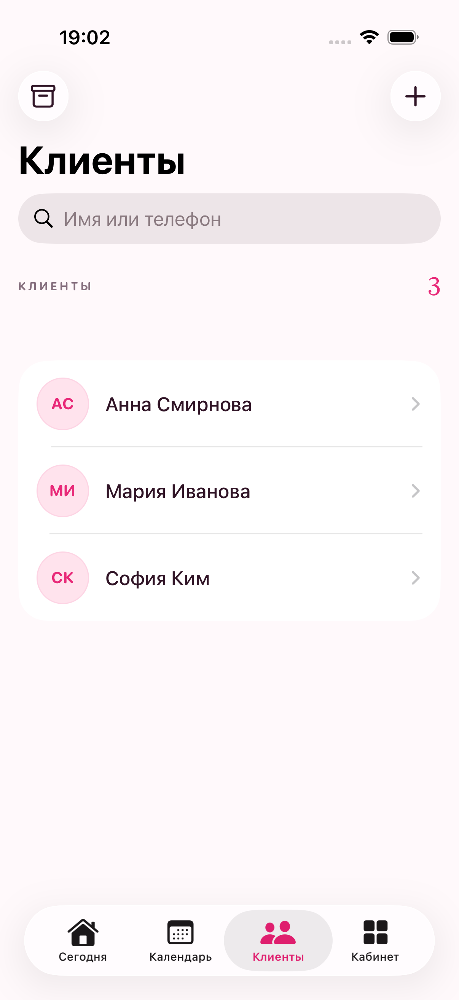
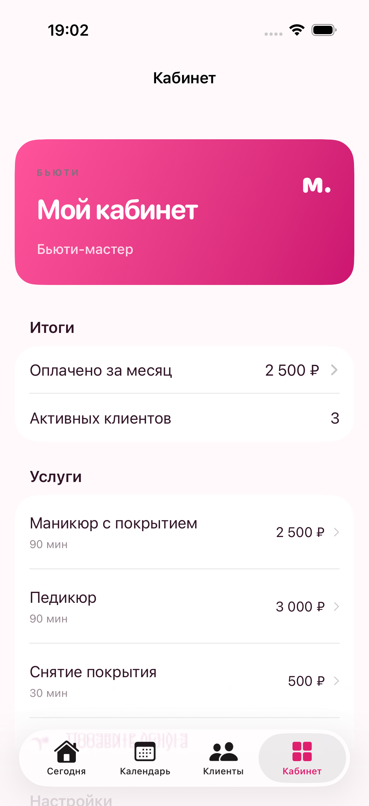
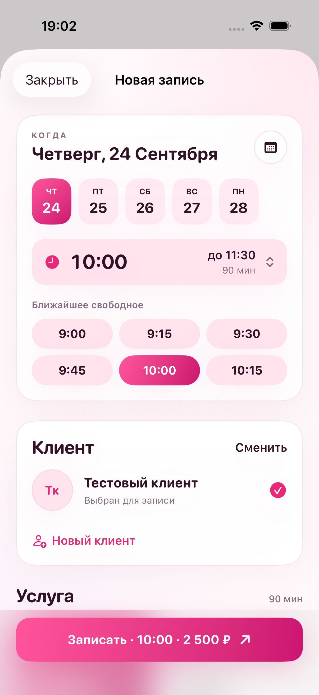
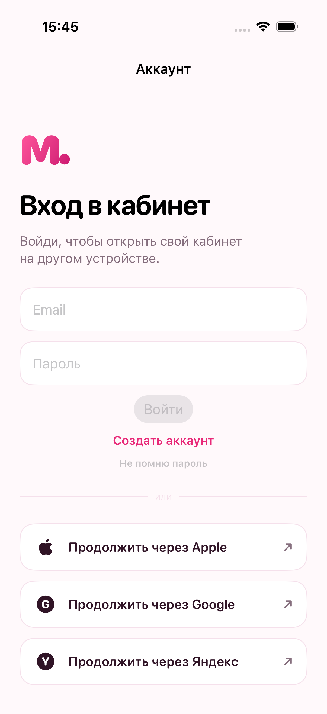
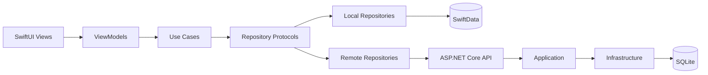

<p align="center">
  
</p>

<h1 align="center">MoyKabinet</h1>

<p align="center">
  Удобный кабинет для специалистов и репетиторов: клиенты, расписание,<br>повторяющиеся занятия, календарь и онлайн-запись в одном приложении.
</p>

<p align="center">
  
  
  
  
</p>

## О проекте

**MoyKabinet** — offline-first iOS-приложение для самостоятельных специалистов: репетиторов, мастеров, консультантов и других профессионалов, которые работают с клиентами по расписанию.

Приложение сохраняет данные локально и синхронизирует их с ASP.NET Core API. Сервер поддерживает регистрацию, вход, обновление токенов, клиентов, записи, повторения и публичные ссылки для онлайн-записи.

## Возможности

| Раздел | Что доступно |
|---|---|
| Расписание | День и неделя, создание и редактирование записей, удобный выбор времени |
| Повторения | Еженедельные занятия и серии повторяющихся записей |
| Клиенты | Контакты, заметки, Telegram и другие ссылки |
| Календарь | Импорт событий из системного календаря через EventKit |
| Онлайн-запись | Публичная страница специалиста и доступные временные слоты |
| Офлайн-режим | Локальное хранение и очередь синхронизации |
| Темы | Три визуальных оформления для разных сценариев работы |
| Безопасность | Access/refresh tokens, ротация refresh-токенов, Keychain и серверная валидация |

## Интерфейс

<table>
  <tr>
    <td></td>
    <td></td>
    <td></td>
  </tr>
  <tr>
    <td align="center">Сегодня</td>
    <td align="center">Новая запись</td>
    <td align="center">Клиенты</td>
  </tr>
  <tr>
    <td></td>
    <td></td>
    <td></td>
  </tr>
  <tr>
    <td align="center">Кабинет</td>
    <td align="center">Новая запись</td>
    <td align="center">Аккаунт</td>
  </tr>
</table>

## Технологии

### iOS

- Swift 6 и SwiftUI
- MVVM и Clean Architecture
- SwiftData для локального хранения
- EventKit для интеграции с календарём
- Keychain для токенов
- async/await и URLSession
- XCTest

### Backend

- ASP.NET Core 10 Minimal API
- Entity Framework Core и SQLite
- JWT access tokens и ротация refresh-токенов
- BCrypt для хеширования паролей
- OAuth-подготовка для Apple, Google и Яндекс
- Swagger / OpenAPI
- xUnit

## Архитектура



Основные слои iOS-клиента:

- `Presentation` — экраны, компоненты и ViewModel;
- `Domain` — модели, use case и контракты репозиториев;
- `Data` — API, локальное хранение и реализации репозиториев;
- `Core` — дизайн-система, навигация, конфигурация и общие сервисы.

Сервер разделён на:

- `MoyKabinet.Api` — HTTP endpoints, middleware и конфигурация;
- `MoyKabinet.Application` — сценарии приложения и контракты;
- `MoyKabinet.Domain` — доменные сущности и правила;
- `MoyKabinet.Infrastructure` — EF Core, безопасность и внешние интеграции.

## Быстрый старт

### iOS-приложение

Требования: macOS, Xcode 16+, iOS 17+.

```bash
open MoyKabinet.xcodeproj
```

Выберите схему `MoyKabinet`, симулятор iPhone и нажмите **Run**.

### Сервер

Требования: .NET SDK 10.

```bash
cd Server.AspNetCore
dotnet restore --locked-mode
dotnet run --project src/MoyKabinet.Api
```

После запуска:

- API: `http://127.0.0.1:8787`
- Swagger UI: `http://127.0.0.1:8787/swagger`
- Health check: `http://127.0.0.1:8787/health`

На macOS также можно использовать:

```bash
cd Server.AspNetCore
./run-server.command
```

### Visual Studio Code

Откройте корень проекта в VS Code и запустите конфигурацию **MoyKabinet API (Swagger)**. Рекомендуемые расширения будут предложены автоматически из `.vscode/extensions.json`.

## Конфигурация

Development-конфигурация находится в `Server.AspNetCore/src/MoyKabinet.Api/appsettings.Development.json`. Секреты для production нельзя добавлять в Git — используйте переменные окружения, Secret Manager или хранилище секретов вашего облака.

Основные переменные окружения:

```text
ConnectionStrings__Default
Jwt__Issuer
Jwt__Audience
Jwt__SigningKey
```

Настройка OAuth-провайдеров подробно описана в [AUTH_SETUP.md](AUTH_SETUP.md).

## Проверка

```bash
# Доменная проверка Swift
swiftc MoyKabinet/Domain/Models/*.swift Tests/main.swift -o /tmp/moykabinet-domain-tests
/tmp/moykabinet-domain-tests

# XCTest без подписи
xcodebuild test \
  -project MoyKabinet.xcodeproj \
  -scheme MoyKabinet \
  -destination 'platform=iOS Simulator,name=iPhone 17 Pro' \
  CODE_SIGNING_ALLOWED=NO

# Backend
cd Server.AspNetCore
dotnet test MoyKabinet.Server.slnx --locked-mode
```

Текущее состояние проекта: **25 доменных проверок Swift**, **15 XCTest**, **2 UI-теста** и **8 backend-тестов** проходят успешно. Один интеграционный XCTest ожидаемо пропускается, если внешний API не запущен.

## Безопасность

Перед публикацией проект проверен на случайно добавленные ключи, токены, базы данных и артефакты сборки. Правила безопасной конфигурации и порядок сообщения об уязвимостях находятся в [SECURITY.md](SECURITY.md).

## Структура репозитория

```text
MoyKabinet/
├── MoyKabinet/                 # iOS-приложение
├── Server.AspNetCore/          # ASP.NET Core API и тесты
├── Tools/DotnetTemplates/      # Шаблон API со Swagger для dotnet new
├── Screenshots/                # Скриншоты интерфейса
├── .github/                    # CI и Dependabot
├── AUTH_SETUP.md               # Настройка OAuth
├── PLAN.md                     # Этапы развития продукта
├── SECURITY.md                 # Политика безопасности
└── VALIDATION.md               # Результаты проверок
```

## Статус

Проект находится в активной разработке. Архитектура и основные пользовательские сценарии готовы; перед production-релизом потребуются production-секреты, OAuth credentials, серверная инфраструктура и публикация iOS-приложения в App Store Connect.
